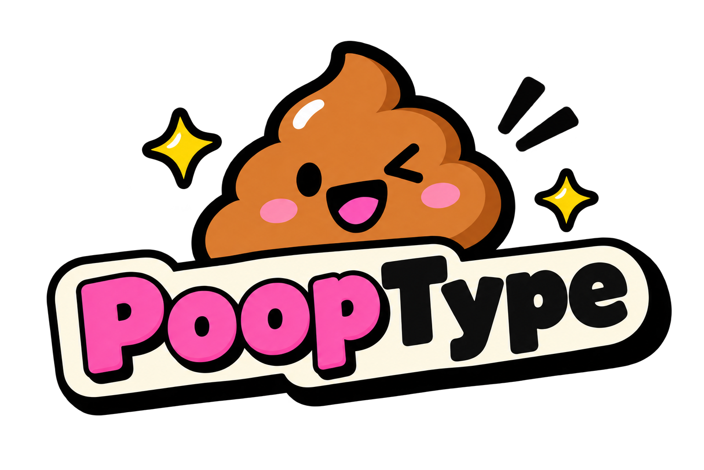
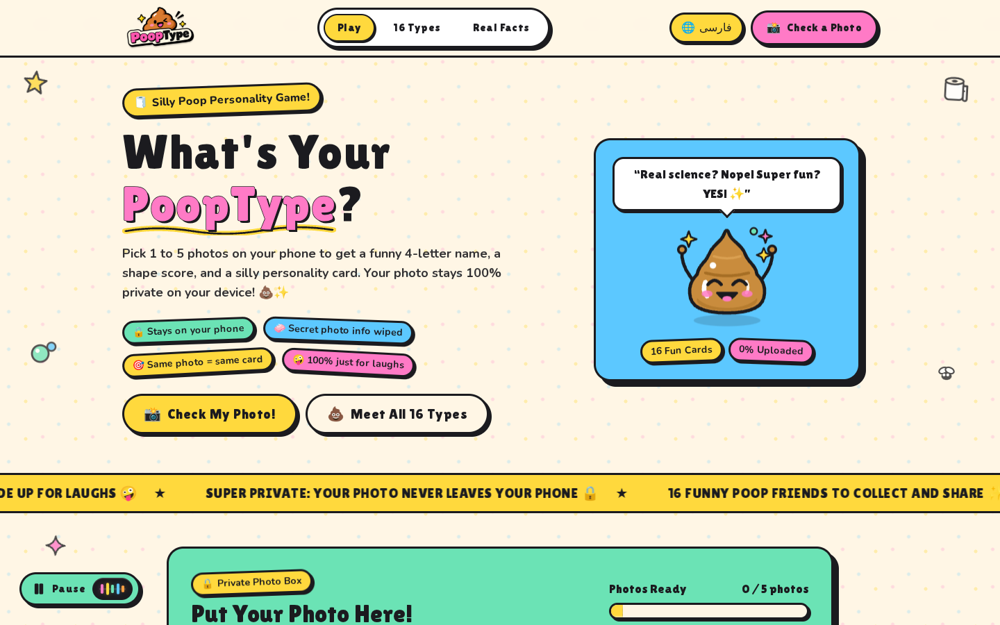
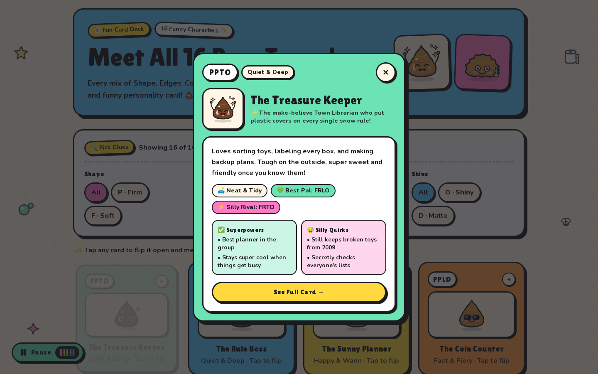
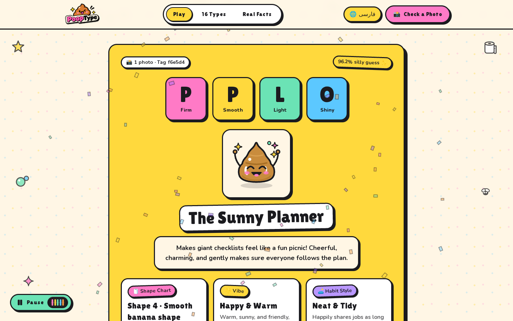
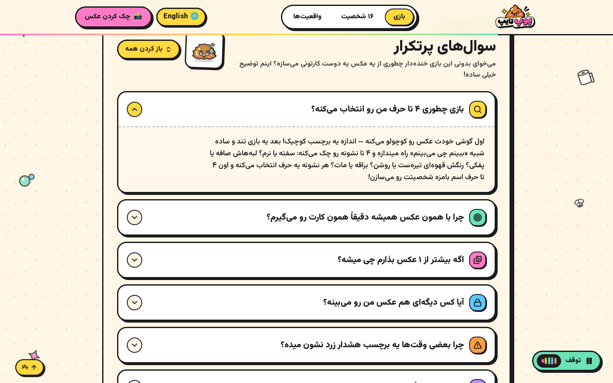

<div align="center">



# 💩 PoopType

### *100% Peer-Unreviewed Bathroom Pseudoscience — Now With Cute Sound Effects.*

> *"Myers-Briggs made you answer 93 exhausting questions about whether you prefer parties or books. PoopType just needs one brave trip to the bathroom and 3 seconds of client-side math."*

[](#the-official-unscientific-disclaimer)
[](#the-sacred-bathroom-privacy-pact)
[](#screenshots--tour-of-the-throne-room)
[](#run-it-yourself-no-plumber-required)

</div>

---

## 🤔 Wait... What Did You Just Build?

**PoopType** is a kawaii sticker-book parody personality game that turns **1 to 5 photos** (processed **100% locally in your browser** — we genuinely do not want your photos on our servers, please keep them) into:

- 🏷️ **A deterministic 4-letter PoopType code** (like `PPTO — The Treasure Keeper` or `PPLO — The Sunny Planner`)
- 🧻 **An estimated Bristol Stool Scale score** (1 to 7, lovingly translated into kid-friendly shapes)
- 📊 **Five completely made-up Big Five personality meters** + superpowers, silly quirks, best pal, and arch-rival
- 🖼️ **A downloadable cartoon PNG trading card** (with photos **OFF** by default so you don't accidentally traumatize the family group chat)
- 🎵 **Auto-playing background music**, a **5-bar candy soundwave visualizer**, **wiggling pastel polka dots** that dance along to the song, and **subtle kawaii Web Audio sound effects** (bubble pops, 3D card-flip sparkles, ascending reveal chimes, and a celebratory mini-fanfare!)
- 🌐 **Full English (LTR) + Native Persian / فارسی (RTL)** support, complete with localized kawaii sticker logos

> ⚠️ **The Official Unscientific Disclaimer:**
> This app is **100% for laughs**. It is **not** medical advice, **not** psychological advice, and **not** a substitute for eating a vegetable once in a while. If a photo looks unusually red, black/tarry, or pale/clay-colored, the app pops up a friendly yellow **Vibe Alert** sticker reminding you to check with a real doctor — because real doctors actually went to school for this.

---

## 📸 Screenshots (Tour of the Throne Room)

### 🏠 Home — Sticker-Book Chaos & Dancing Candy Visualizer
Winking mascot, private photo dropbox, floating Play/Pause candy waveform visualizer, and pastel background dots that slowly wiggle up and down while the music plays.

<p align="center">
  
</p>

---

### 🃏 All 16 Collectible PoopTypes (With 3D Flipping Cards!)
Filter all 16 archetypes by Shape, Edges, Color, or Shine, and tap any trading card to flip it open in 3D with a tiny sparkle sound.

<p align="center">
  
</p>

---

### 🎉 The Grand Result Reveal (Confetti, 4-Letter Tiles & Share Card)
Drumroll → 4 ascending pentatonic tile flips → confetti blast → your official 4-letter trading card, ready to copy, share, or save as a PNG.

<p align="center">
  
</p>

---

### 🌐 Full Persian (RTL) Mode
One tap flips the entire experience into native Persian (`فارسی`) with Vazirmatn typography, a custom Persian sticker logo (`پوپ‌تایپ`), mirrored floating controls, and a jargon-free FAQ explaining how the pixel "I Spy" algorithm works.

<p align="center">
  
</p>

---

## 🔬 How Our "Algorithm" Actually Works

No cloud AI. No sneaky servers. Just honest, deterministic **HTML Canvas pixel math + SHA-256** right on your screen:

1. **Honey, I Shrunk the Photo**: Your browser redraws the image onto a tiny offscreen canvas (max `128px`) — which instantly **wipes all secret EXIF & GPS metadata** (so nobody knows which Taco Bell inspired your masterpiece).
2. **A Quick Game of "I Spy" Across 4 Clues**:

| Clue | Letter A | Letter B | How the Pixels Decide |
| :--- | :--- | :--- | :--- |
| **1. Shape** | **`P`** — Firm *(Packed)* | **`F`** — Soft *(Free-flowing)* | Connected-component blob count & elongation (maps to Bristol 1–7) |
| **2. Edges** | **`P`** — Smooth *(Precise)* | **`R`** — Bumpy *(Ragged)* | 3×3 Sobel edge-detection density around the silhouette |
| **3. Color** | **`T`** — Dark *(Toasted)* | **`L`** — Light *(Light)* | Center-weighted CIE `L*` lightness inside the earth-tone band |
| **4. Shine** | **`O`** — Shiny *(Oily)* | **`D`** — Matte *(Dry)* | Ratio of bright specular highlight pixels |

3. **Same Photo = Same Card (Forever)**: A local `SHA-256` hash seeds tie-breakers and the `"Confidence: XX.X% (made up)"` badge, so uploading the exact same photo twice always awards the exact same 4-letter destiny.
4. **Poop Portfolio Mode (1–5 Photos)**: Uploading multiple photos averages your clues across your *body of work*. Truly visionary.

---

## 🔒 The Sacred Bathroom Privacy Pact

We take bathroom privacy more seriously than anything else in this repo:

- **0 bytes uploaded**: There are literally zero upload endpoints, zero databases, and zero third-party AI calls. Turn off your Wi-Fi and it still works!
- **EXIF & GPS incinerated**: Every image is redrawn onto a fresh `<canvas>` immediately, stripping camera metadata before analysis or thumbnails.
- **Image-free share links**: Shared URLs (`/result/PPLO?b=4&c=96.2&t=68...`) encode only your 4-letter code and summary numbers — never your photo.
- **Safe-by-default PNG cards**: Exported share cards leave photos **OFF** unless you intentionally check the opt-in box.

---

## 🚀 Run It Yourself (No Plumber Required)

```bash
# 1. Install dependencies (automatically installs the Next.js app in ./poop-type too)
npm install

# 2. Start the dev server on http://localhost:3000
npm run dev
```

Other handy commands:

```bash
# Production build
npm run build

# Lint + TypeScript typecheck
npm run lint

# Run all 19 unit tests (canvas heuristics, SFX engine, music state, back-to-top, smooth scroll)
npx tsx --test poop-type/lib/*.test.ts
```

---

## 🧰 Under the Hood (Actual Serious Tech Stack)

- **Next.js 16 (App Router)** + **React 19** + **TypeScript**
- **Tailwind CSS v4** — Custom kawaii candy palette, hard comic shadows, and GPU-composited wiggling dot & equalizer keyframes
- **Framer Motion** — Snappy springs, 3D card-flip modals, staggered scroll reveals, and full `prefers-reduced-motion` support
- **Lucide React** — Crisp outline icons for accordions, Back-to-Top, and media controls
- **Web Audio API** (`lib/kawaii-sfx.ts`) — Zero-asset synthesized kawaii UI sound effects (soft sine/triangle waves through a 3.2 kHz low-pass filter)
- **HTML Canvas API & Web Crypto API** (`lib/analyze.ts`, `lib/share-card.ts`) — 100% client-side pixel analysis, SHA-256 determinism, and PNG trading card generation

---

<div align="center">

*Made for laughs. Please wash your hands before opening a pull request.* 🧼✨

</div>
